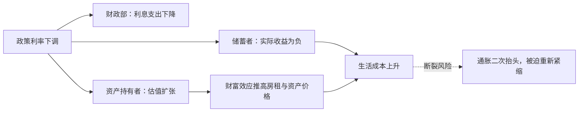
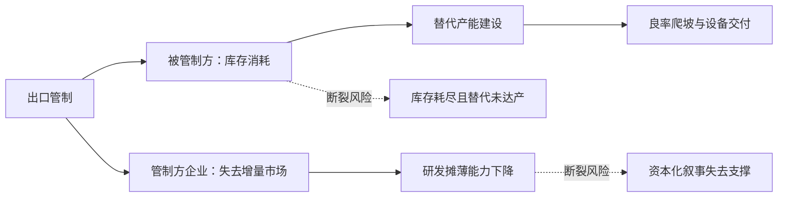

# 示例分析（压缩范例）

以下为结构示范，数字为示意占位，实际分析必须替换为可查证数据。

---

## 示例一：央行降息

### 一句话结论

降息的核心矛盾是"债务存量要求低利率滚续"与"实体剩余价值创造不足以支撑存量债务"之间的对立；矛盾的主要方面在债务方（财政与资产持有者），基准走向是用名义增长与负实际利率稀释债务。

### 1. 核心矛盾

- **候选 1**：债务滚续需求 vs 剩余价值创造能力（围绕"调整成本由谁承担"）。
- **候选 2**：资产持有者 vs 工资劳动者（围绕"实际利率与生活成本"）。
- **候选 3**：中心货币国 vs 储蓄国（围绕"汇率与调整责任"）。
- **主要矛盾**：候选 1。债务到期墙集中、利息支出刚性，决定了其他矛盾的展开方式。
- **主要方面**：债务方占支配地位，因为它掌握货币政策与财政主导权；其支配依赖"通胀不失控 + 长端利率不反弹"。
- **对抗性**：短期非对抗（可用通胀与规则调整分摊），若通胀失控或财政空间耗尽则转向对抗。

### 2. 四维展开

**时间**
- 【事实】政府债务加权久期短、到期墙集中在未来 24 个月，利息支出已占财政支出较大比例。
- 【推断】降息 100bp 的直接受益者首先是财政部与存量浮动利率债务人，而非新增投资。
- 脆弱性：若长端收益率因通胀预期不跟随下行，"短端降、长端升"会使期限溢价成为新的成本源。

**空间**
- 【推断】本币走弱 → 输入型通胀 → 储蓄国（出口导向经济体）承担部分调整成本。
- 卡点：能源与关键中间品以美元计价，降息周期内美元融资条件放松，边缘国家外债压力短期缓解、长期加重。

**阶级**
- 获益：资产持有者（估值扩张）、高杠杆企业（利息下降）、财政部（债务货币化空间）。
- 承担：储蓄者（实际利率为负）、依赖固定收入的退休群体、未持有资产的工资劳动者（房租与食品价格上涨）。
- 底线：家庭债务/收入已高，降息可短期续命，但同时抬高了后续紧缩的政治成本。

**强制**
- 梯度位置：规则层面（货币政策），尚未升级。
- 实物约束：若降息推动需求而能源供给受限，通胀将以实物短缺形式回归。

### 3. 矛盾运动与临界点

- 量变：利息支出占比、家庭债务/收入、储蓄率、期限溢价。
- 断裂点 1：通胀预期脱锚 → 长端上行 → 估值与财政同时受损（高可能，滞后 6–12 个月）。
- 断裂点 2：银行体系不放贷，宽货币停在准备金层面（中可能，先行指标：信贷脉冲、贷款标准调查）。
- 红灯：若股指与长端收益率同涨，视为无风险资产信用受损与盈利预期集中同时出现 → **`危机临界点`**。

### 4. 可能走向

| 走向 | 解决形式 | 触发条件 | 时间尺度 | 先行指标 | 置信度 |
|---|---|---|---|---|---|
| 基准：通胀化债 | 制度性调节 + 成本外移 | 名义 GDP 增速高于平均债务成本；央行容忍通胀超调 | 2–5 年 | 实际利率、期限溢价、工资增速 | 中 |
| 财政紧缩 | 一方压倒另一方 | 通胀失控 + 政治转向平衡财政 | 1–2 年 | 福利支出、公共投资削减 | 中 |
| 债务重组/资本征税 | 制度性调节 | 财政空间耗尽 + 政治力量左转 | 多年 | 财富税提案、债务减记谈判 | 低 |

基准走向说明：通胀化债不需要正式违约，政治阻力最小，但会把成本压给储蓄者与固定收入群体。分歧信号：若长端收益率在降息周期中反而上行，基准走向切换为"财政紧缩 + 估值重定价"。

### 5. 启示

- 跨走向防御性：现金流稳定、定价权强、负债久期长的实体资产运营方。
- 生产性锚定：能源与电力基础设施、可替代进口的关键中间品产能。
- 待验证：依赖低贴现率维持的高久期成长资产。

### 6. 反面检验

若通胀预期稳定、长端下行、信贷脉冲回升，则"成本转移到储蓄者"的判断被削弱，主流解释成立。

---

## 示例二：技术出口管制升级

### 一句话结论

管制的核心矛盾是"霸权护持要求技术封锁"与"资本增殖要求进入最大增量市场"之间的对立；矛盾的主要方面在安全逻辑一侧，基准走向是管制长期化、路径重组与成本上升，而非彻底断裂。

### 1. 核心矛盾

- **候选 1**：霸权护持 vs 资本增殖（围绕"是否放弃增量市场"）。
- **候选 2**：被管制方产业升级 vs 外部技术依赖（围绕"替代时间"）。
- **候选 3**：管制方盟友 vs 第三方转口网络（围绕"执行边界"）。
- **主要矛盾**：候选 1。它决定管制强度、豁免范围与盟友协同方式。
- **主要方面**：安全逻辑当前占支配地位，依赖"国内政治共识 + 盟友配合 + 对手替代速度慢于封锁"。
- **对抗性**：对抗性，但在企业游说与选举周期下存在局部豁免空间。

### 2. 四维展开

**时间**
- 【推断】被管制方的资本开支从"扩产"转向"补链"，短期折旧上升、回报周期拉长。
- 管制方的设备与设计企业面临收入缺口，若研发投入刚性，FCF 承压。

**空间**
- 卡点矩阵：先进制程（CR3 极高、替代周期 3–5 年）、EDA 工具（替代周期更长）、关键设备零部件。
- 【事实】管制清单逐轮扩展至设备维护与人员服务，说明前几轮未达预期效果。
- 逆向反噬：管制方企业失去增量市场 → 研发摊薄能力下降 → 下一代技术领先幅度收窄。

**阶级**
- 管制方：资本端获得政策租金（补贴 + 排他市场），工程师与制造业工人承担就业波动。
- 被管制方：成本通过财政补贴与终端价格转移给纳税人/消费者；高强度研发挤压当期工资增长空间。

**强制**
- 梯度位置：出口管制 → 长臂管辖，接近物理断供。
- 实物约束：可交割库存是短期唯一缓冲；替代产能受设备交付周期与良率爬坡限制。

### 3. 矛盾运动与临界点

- 量变：库存周数、设备交付周期、替代产能良率、管制方企业收入缺口。
- 断裂点 1：库存耗尽 vs 替代达产的时间差（先行指标：设备交付周期、成熟制程转单量、良率公告）。
- 断裂点 2：管制方 AI 资本开支的回报率下滑（先行指标：数据中心空置率、云厂商资本开支指引）。
- 红灯：关键实物产能或物流节点出现物理性断供，虚拟资本无法兑现实物 → **`危机临界点`**。

### 4. 可能走向

| 走向 | 解决形式 | 触发条件 | 时间尺度 | 先行指标 | 置信度 |
|---|---|---|---|---|---|
| 基准：管制长期化 + 路径重组 | 矛盾向外转移 | 安全共识不变；第三方转口与本地替代同时推进 | 3–5 年 | 转口贸易份额、替代良率、豁免清单 | 中高 |
| 局部脱钩后谈判交换 | 制度性调节 | 管制方企业损失扩大 + 政治上需要成果 | 1–3 年 | 企业游说强度、出口许可发放量 | 中 |
| 升级为金融/军事强制 | 一方压倒另一方 | 经济手段失效 + 误判或同盟义务触发 | 季度级 | 制裁清单扩展、航道与基地部署 | 低 |

基准走向说明：全面断裂成本过高，双方都会通过第三国与库存缓冲维持部分循环，但成本持续上升。分歧信号：若替代产能良率提前达标或管制方出现大规模豁免，走向转向"局部脱钩后谈判交换"。

### 5. 启示

- 跨走向防御性：位于卡点两侧、具备实物产能与长协订单的环节。
- 生产性锚定：设备、材料、零部件的国产替代；电力与算力基础设施。
- 待验证：完全依赖单一市场增量假设的算力资本化模式。

### 6. 反面检验

若管制执行出现大规模豁免、第三方转口网络迅速成型，则"物理断供"判断失效，事件退回关税层面的成本再分配。
