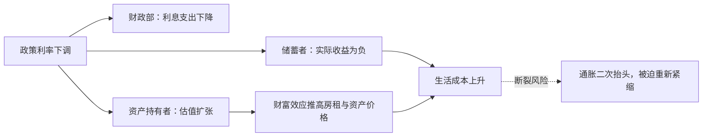
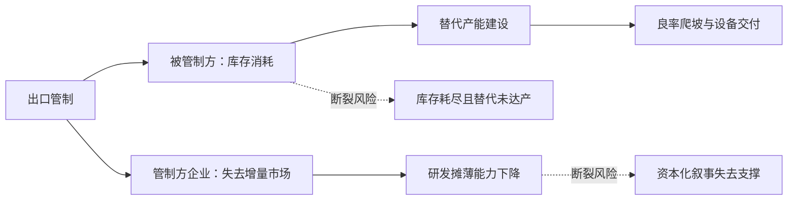

# 示例分析（压缩范例）

以下为结构示范，数字为示意占位，实际分析必须替换为可查证数据。

---

## 示例一：央行降息

### 一句话结论

降息表面是逆周期调节，实质是把付息成本从高杠杆部门转移到储蓄者与未来税基；链条的断点不在利率，而在通胀二次抬头后被迫重新加息时的估值重定价。

### 1. 现象剥离

主流叙事：经济走弱 → 降息 → 融资成本下降 → 投资与消费回升。
未检验的假设：需求对利率敏感；银行体系愿意扩张信贷；通胀预期锚定稳定。

### 2. 四维穿透

**时间**
- 【事实】政府债务加权久期短、到期墙集中在未来 24 个月，利息支出已占财政支出较大比例。
- 【推断】降息 100bp 的直接受益者首先是财政部与存量浮动利率债务人，而非新增投资。
- 脆弱性：若长端收益率因通胀预期不跟随下行，"短端降、长端升"会使期限溢价成为新的成本源。

**空间**
- 【推断】本币走弱 → 输入型通胀 → 储蓄国（出口导向经济体）承担部分调整成本。
- 卡点：能源与关键中间品以美元计价，降息周期内美元融资条件放松，边缘国家外债压力短期缓解、长期加重。

**阶级**
- 获益：资产持有者（估值扩张）、高杠杆企业（利息下降）、财政部（债务货币化空间）。
- 承担：储蓄者（实际利率为负）、依赖固定收入的退休群体、未持有资产的工资劳动者（房租与食品价格上涨）。
- 底线：家庭债务/收入已高，降息可短期续命，但同时抬高了后续紧缩的政治成本。

**强制**
- 梯度位置：规则层面（货币政策），尚未升级。
- 实物约束：若降息推动需求而能源供给受限，通胀将以实物短缺形式回归。

### 3. 断裂点

1. 通胀预期脱锚 → 长端上行 → 估值与财政同时受损（高可能，滞后 6–12 个月）。
2. 银行体系不放贷，宽货币停在准备金层面（中可能，先行指标：信贷脉冲、贷款标准调查）。

### 4. 红灯

经济红灯：若股指与长端收益率同涨，视为无风险资产信用受损与盈利预期集中同时出现 → **`危机临界点`**。

### 5. 启示

- 防御性：现金流稳定、定价权强、负债久期长的实体资产运营方。
- 生产性锚定：能源与电力基础设施、可替代进口的关键中间品产能。
- 待验证：依赖低贴现率维持的高久期成长资产。

### 6. 反面检验

若通胀预期稳定、长端下行、信贷脉冲回升，则"成本转移到储蓄者"的判断被削弱，主流解释成立。

---

## 示例二：技术出口管制升级

### 一句话结论

管制的实质是在技术端做实物断供，用行政手段冻结对手的产业升级时间表；断点在于管制方的资本化叙事失去最大增量市场后的造血能力，以及被管制方替代周期与库存缓冲的赛跑。

### 1. 现象剥离

主流叙事：国家安全 → 防止技术扩散 → 盟友协同。
未检验的假设：管制可精准执行；替代产能无法在窗口期内建成；对手的反制手段有限。

### 2. 四维穿透

**时间**
- 【推断】被管制方的资本开支从"扩产"转向"补链"，短期折旧上升、回报周期拉长。
- 管制方的设备与设计企业面临收入缺口，若研发投入刚性，FCF 承压。

**空间**
- 卡点矩阵：先进制程（CR3 极高、替代周期 3–5 年）、EDA 工具（替代周期更长）、关键设备零部件。
- 【事实】管制清单逐轮扩展至设备维护与人员服务，说明前几轮未达预期效果。
- 逆向反噬：管制方企业失去增量市场 → 研发摊薄能力下降 → 下一代技术领先幅度收窄。

**阶级**
- 管制方：资本端获得政策租金（补贴 + 排他市场），工程师与制造业工人承担就业波动。
- 被管制方：成本通过财政补贴与终端价格转移给纳税人/消费者；高强度研发挤压当期工资增长空间。

**强制**
- 梯度位置：出口管制 → 长臂管辖，接近物理断供。
- 实物约束：可交割库存是短期唯一缓冲；替代产能受设备交付周期与良率爬坡限制。

### 3. 断裂点

1. 库存耗尽 vs 替代达产的时间差（先行指标：设备交付周期、成熟制程转单量、良率公告）。
2. 管制方 AI 资本开支的回报率下滑（先行指标：数据中心空置率、云厂商资本开支指引）。

### 4. 红灯

地缘红灯：关键实物产能或物流节点出现物理性断供，虚拟资本无法兑现实物 → **`危机临界点`**。

### 5. 启示

- 防御性：位于卡点两侧、具备实物产能与长协订单的环节。
- 生产性锚定：设备、材料、零部件的国产替代；电力与算力基础设施。
- 待验证：完全依赖单一市场增量假设的算力资本化模式。

### 6. 反面检验

若管制执行出现大规模豁免、第三方转口网络迅速成型，则"物理断供"判断失效，事件退回关税层面的成本再分配。
