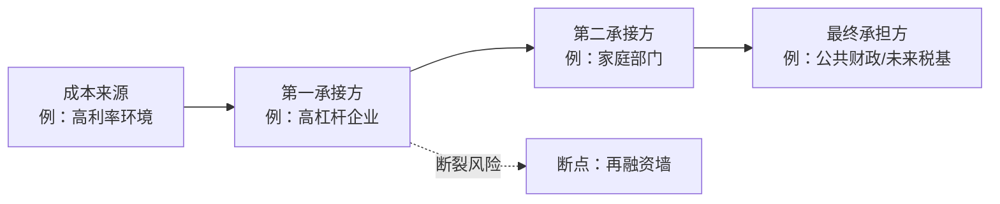

# 输出模板

直接复制以下骨架填写。方括号内为填写要求，输出时删除提示语。

---

## 0. 一句话结论

> [一句话写出：核心矛盾是什么（A 与 B 围绕 X），矛盾的主要方面在哪一侧，基准走向是什么。判断必须可被证伪。]

## 1. 事实基线

| 项目 | 内容 | 来源 / 日期 | 可信度 |
|---|---|---|---|
| 事件与时间 | | | |
| 直接主体 | | | |
| 规模（金额、占比、数量级） | | | |
| 传导机制 | | | |
| 已发生事实 | | | |
| 市场预期 / 官方口径 | | | |
| 关键数据缺口 | | | |

## 2. 核心矛盾

### 2.1 矛盾候选

| 排序 | 矛盾（A 与 B 围绕 X） | 相互依存条件 | 激化指标 | 证据 |
|---|---|---|---|---|
| 1 | | | | |
| 2 | | | | |
| 3 | | | | |

### 2.2 主要矛盾与主要方面

- **主要矛盾**：[A 与 B 围绕 X 的对立]
- **矛盾的主要方面**：[哪一侧当前占支配地位；依赖什么条件]
- **次要矛盾及其关系**：[被支配 / 被掩盖 / 可能转化]
- **对抗性判断**：[对抗性 / 非对抗性 / 转化中] + 依据（成本分担空间、政治可行性）

### 2.3 增殖—实现校验

- **增殖率叙事**：[当前事件依赖怎样的收益率/增长故事？是否已资本化进价格？]
- **金融时间转移**：[信贷、债务、估值把多少未来收益提前到当下？]
- **空间集聚**：[资本在哪个空间节点集聚？靠什么吸引更多资本？]
- **现金分发**：[多少进入工资、采购与消费？多少停留在金融资产？]
- **人口边界**：[劳动份额、总人口/劳动人口、总需求是否支撑当前资本规模？]
- **结论**：[事件在缓解还是激化增殖—实现矛盾？是在推迟边界还是重置资本？]

## 3. 四维展开

### 3.1 时间维度：矛盾如何被推给未来

- **未来假设**：[当前收益依赖哪些未来条件]
- **证据**：【事实】… /【推断】…
- **脆弱性**：[久期、FCF、贴现率敏感度]

### 3.2 空间维度：矛盾如何向外转移与反噬

- **流向**：[从谁到谁，用账户或持仓数据支撑]
- **卡点**：[节点、集中度、替代周期、库存缓冲]
- **反噬**：[核心国自身承受的成本]

### 3.3 阶级维度：成本落在谁身上

- **获益方**：[主体 + 获益形式]
- **承担方**：[主体 + 承担形式]
- **底线缓冲**：[实际工资、家庭债务、社会支出等]

### 3.4 强制维度：矛盾是否升级为暴力与实物阻断

- **梯度位置**：[规则/关税/制裁/管制/长臂/断供/军事]
- **实物硬约束**：[品类、库存、替代时间]
- **兑现风险**：[虚拟资本能否兑现实物]

## 4. 成本转移链条

节点必须是具体主体，边上的标签写清楚转移机制（利率、税、价格、工资、汇率）。

## 5. 矛盾运动与临界点

### 5.1 量变积累

| 缓冲类型 | 当前水平 | 变化方向 | 耗尽信号是否出现 |
|---|---|---|---|
| 金融 / 实物 / 财政 / 社会 / 政治 / 外部 | | | |

### 5.2 断裂点

| 排序 | 断点 | 触发条件 | 先行指标 | 时滞 | 置信度 |
|---|---|---|---|---|---|
| 1 | | | | | |
| 2 | | | | | |

### 5.3 红灯校验

- 经济红灯：[触发 / 未触发] + 依据
- 政治红灯：[触发 / 未触发] + 依据
- 地缘红灯：[触发 / 未触发] + 依据
- 社会红灯：[触发 / 未触发] + 依据

> 若任一触发，此处必须写明：**`危机临界点`**

## 6. 可能走向

| 走向 | 解决形式 | 触发条件 | 时间尺度 | 先行指标 | 置信度 |
|---|---|---|---|---|---|
| **基准**：[名称] | [压倒 / 价值毁灭 / 重组 / 空间外移 / 时间外移 / 调节] | | | | |
| 走向 B：[名称] | | | | | |
| 走向 C：[名称] | | | | | |

**基准走向说明**：[为什么它概率最高；与主要矛盾、量变指标如何对应。]

**分歧信号**：[出现什么变化会把基准走向切换到另一条路径。]

## 7. 启示

### 7.1 跨走向的防御性

[在多数走向下都能保住购买力与现金流的结构性位置]

### 7.2 生产性锚定

[真实创造使用价值、位于卡点、可被实物验证的产能与技术]

### 7.3 叙事待验证

[只在特定走向下成立的方向 + 验证指标 + 失效条件]

> 本节只讨论结构性含义，不构成投资建议，不提供点位、目标价或仓位比例。

## 8. 反面检验

- 如果本框架错了，最可能错在：[哪一步推理 / 哪条假设]
- 能推翻当前判断的证据：[具体指标及方向]
- 主流解释在什么条件下才成立：[条件]

## 9. 证据与免责

- 数据来源：[机构、报告名、日期]；未获取到的数据：[列明]
- 本文为分析框架演练，不构成投资、法律或政策建议。
